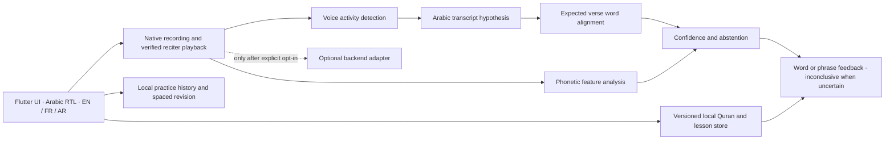

# Iqra · Quran learning prototype

An installable, mobile-first web prototype for a careful Quran learning experience. The workspace had no existing app, and Flutter, Dart, and Java executables were not available on `PATH`; a native Android build could not be evaluated here. This first increment uses plain HTML, CSS, and JavaScript with no third-party runtime dependencies. It works in a mobile browser and can be installed as a PWA. The current app shell is offline-capable after its first visit.

## Run it

Requires Node.js 18 or newer. From this directory:

```sh
npm start
```

Open <http://localhost:4173>. `localhost` is a secure context for browser microphone permission. The development server listens on this computer only; a phone cannot use `127.0.0.1` to reach your computer, and a plain LAN HTTP address will not grant microphone access. Phone use needs an HTTPS origin or a native APK. To run the project checks, use `npm test`.

## What works in this increment

- Home, reader, practice, learning, and progress screens with a calm, responsive mobile layout.
- English, French, and Arabic interface labels, RTL support for the Arabic interface, and a single attributed Uthmani verse.
- Browser-local practice history and a daily practice goal.
- Microphone recording and playback using the browser's `MediaRecorder` API. A recording is temporary unless the learner explicitly checks “Keep this recording”; chosen audio is stored in IndexedDB on this device and can be deleted.
- Real recitation for Al-Fātiḥah 1:1 by Mishary Rashid Alafasy, bundled as a local audio file. Playback does not call Al Quran Cloud or another audio service.
- A service worker caches the app shell and bundled verse audio for offline reopening after first load. The app does not need a third-party runtime service; the local Node server is only for running the development build.
- Draft Tajweed lesson notes are labelled as requiring teacher review.

## Trust and scope

The reader contains only Al-Fātiḥah 1:1, copied verbatim from the Uthmani Hafs example in the Quran Foundation content API documentation, which identifies the Tanzil Uthmani text. The app carries Tanzil attribution and links to its project and updates. Tanzil terms permit verbatim redistribution with attribution and prohibit changes. See [Tanzil's download and text terms](https://tanzil.net/pub/download/index.php) and [Quran Foundation's verse-by-script documentation](https://api-docs.quran.com/docs/content_apis_versioned/4.0.0/quran-verses-by-script/).

The reference recitation for Al-Fātiḥah 1:1 is bundled locally: Mishary Rashid Alafasy, Alafasy ayah-by-ayah edition, 128 kbps. It was obtained from Al Quran Cloud's documented audio CDN. Their terms permit downloads for personal and educational use and state that recording copyright remains with the reciters; this copy is bundled for the app's educational use and attributed in `assets/audio/ATTRIBUTION.md`. See [Al Quran Cloud's CDN guide](https://alquran.cloud/cdn) and [current audio terms](https://alquran.cloud/terms-and-conditions). Playback does not contact that service and works offline after app install/cache. No Quran recitation is synthesized. The recitation file remains copyrighted by its reciter or rights holder; it is not owned by this app. The prototype does not perform speech recognition, word alignment, phonetic analysis, or Tajweed evaluation, and never uploads learner audio. It never claims that a learner's recitation is correct or incorrect. Its practice result is explicitly inconclusive. Recording requires microphone permission and a secure browser context. History is kept in the browser's local storage; saved audio is in IndexedDB.

The English/French/Arabic copy and Tajweed lesson cards are prototype material. They need linguistic and qualified-teacher review before release. The UI uses system fonts and makes no external font requests.

## Architecture proposal · Stage 1

### Decision record (initial)

| Area | Starting choice | Why | Before production |
|---|---|---|---|
| App | Android-first native Flutter app; this workspace's executable increment is a dependency-free PWA | Flutter offers Android and iOS from one codebase; it is not installed here, so the app can be reviewed now in a browser | Install Flutter and Android Studio/SDK, then move the validated flows into Flutter and test on physical Android devices |
| Core content | Versioned, immutable Hafs Uthmani content, beginning with Tanzil v1.1 | This source identifies a verified Uthmani text and permits verbatim redistribution under its attribution conditions | Import the complete licensed corpus only from the official source; verify checksums, verse/word IDs, and update procedure; get a second review |
| Quran audio | Stream qualified-reciter audio only; prototype streams Alafasy ayah 1 from Al Quran Cloud | Keeps recitation separate from teaching TTS and uses a provider whose current terms permit educational streaming | Confirm continued source availability, add only individually identified reciters and verse mappings; handle offline downloads only under the applicable terms |
| Teaching speech | Android system TTS first, behind a provider interface | Avoids shipping a heavyweight model before Arabic quality, offline voices, and time-to-first-audio are measured | Compare system voices with an offline Arabic TTS model on target devices; use teaching content only |
| Recitation assessment | Separate transcript, expected-text alignment, acoustic feature, and confidence components; abstain by default | General Arabic STT is not a Tajweed assessor; a text match does not certify pronunciation | Build a consented, expert-labelled evaluation set before returning error labels; report confidence and inconclusive outcomes |
| Mobile inference | Benchmark ONNX Runtime Mobile against LiteRT using one candidate at a time | Both provide mobile inference paths; the model, operator coverage, RAM, and latency decide | Measure end-to-end p50/p95 latency, peak RAM, package size, battery, offline behavior, and accuracy on supported mid-range phones |
| Local data | SQLite in the native app; current prototype uses localStorage/IndexedDB | Practice stays useful offline and account sync is not required for the first increment | Define migrations, deletion, encryption at rest, and optional explicit sync before collecting sensitive content |

Flutter installation and Android toolchain requirements are described in [Flutter's official setup docs](https://docs.flutter.dev/platform-integration/android/setup?tab=virtual). ONNX Runtime's official [mobile guide](https://onnxruntime.ai/docs/get-started/with-mobile.html) documents Android/iOS paths and CPU, XNNPACK, NNAPI, and CoreML execution providers. No model is selected on paper as “best”: the available Quranic vocabulary, diacritic behavior, word timing, streaming capability, model license, target RAM, and actual device latency must be measured against the same reviewed recordings. Ordinary STT output is only a transcript hypothesis.

### Proposed flow



### Benchmark and validation plan (not results)

1. Compare candidate lightweight multilingual Arabic STT and mobile-optimized variants on the same consented recordings from novice and fluent speakers, accents, noise conditions, and supported recitation material. Score word error rate on Quranic text, omissions/substitutions/repetitions, word timestamp error, diacritic handling, streaming latency, model size, and peak RAM.
2. Profile on low/mid-range Android devices. Record cold startup, post-utterance result latency (median and p95), memory, battery over a fixed session, audio interruptions, and offline behavior. Do not publish targets as achieved until measured.
3. Evaluate alignment and supported phonetic checks separately from transcript quality. An experienced Tajweed teacher labels every evaluation example and reviews feedback wording. Report confirmed, suspected, and inconclusive rates; reject confidence calibration that overstates correctness.
4. Compare Arabic system TTS and offline teaching TTS for pronunciation quality, offline availability, memory, and time to first audio. Quran references remain separately licensed recordings.
5. Validate Uthmani text checksums and verse boundaries, Arabic shaping/diacritics and RTL, privacy deletion, accessibility, and airplane-mode operation. Keep cloud analysis disabled unless the learner explicitly opts in.

### Implementation sequence

1. This increment: UI shell, reader attribution, on-device recording/playback, practice log, and offline shell.
2. Flutter Android port, local SQLite content, complete verified text and licensed verse audio.
3. Reviewed lesson content, bookmarks, repeat-range audio, and spaced revision.
4. Benchmark candidate speech models; add transcript/alignment only with an abstention path.
5. Add expert-reviewed phonetic/Tajweed checks and optional consent-based advanced backend only where justified.

This is a functional starting prototype, not a release-ready Quran app: it has not been tested on physical Android devices, it has no verified reference audio, and it makes no recitation or Tajweed assessment.
